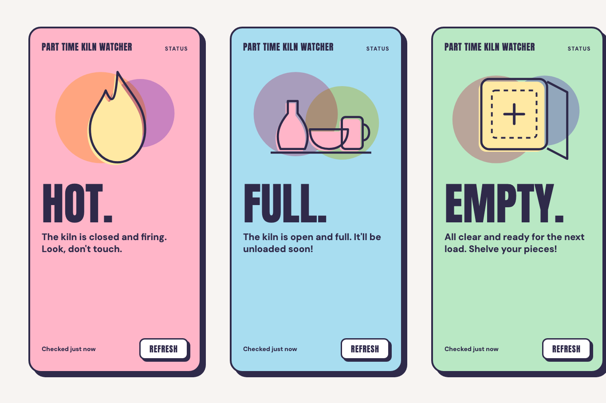
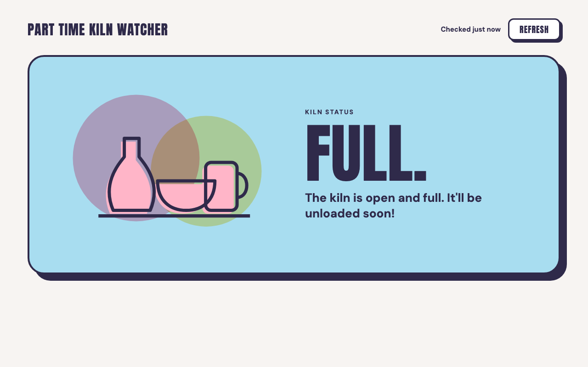

# Design reference: Pastel Riso

This is the final design for the status page. It has one full-colour card per kiln state, a big Anton status word, a short line of copy, and a riso-style icon whose overlapping circles are multiply-blended.

| Mobile (all three states) | Desktop (open and full) |
| --- | --- |
|  |  |

The desktop boards for the other states are [desktop-closed.png](screens/desktop-closed.png) and [desktop-empty.png](screens/desktop-empty.png).

## Files

| Path | What |
| --- | --- |
| `docs/design/Main.dc.html` | Mobile board: three 390 × 780 phone screens |
| `docs/design/Desktop{Closed,Full,Empty}.dc.html` | Desktop board for each state (1280 × 800) |
| `docs/design/canvas.json` | Canvas layout metadata |
| `docs/design/screens/*.png` | Renders of the boards above |
| `public/icons/*.svg` | Icon assets, served at `/icons/...` |

The `.dc.html` files come from the design canvas. They are plain HTML with inline styles, so you can read exact measurements from them. They reference a `support.js` canvas runtime that isn't included and isn't needed.

## Colours

These are also defined as Tailwind theme colours in `app/globals.css`, for example `bg-closed` and `text-ink`.

| Token | Hex | Use |
| --- | --- | --- |
| `ink` | `#2F2A4A` | Text, outlines, hard shadows |
| `page` | `#F7F4F2` | Page background |
| `closed` | `#FFB5C8` | Pink: the `CLOSED` card |
| `full` | `#A8DDF0` | Powder blue: the `OPEN_FULL` card |
| `empty` | `#B9E8C4` | Mint: the `OPEN_EMPTY` card |
| `butter` | `#FFE9A3` | Accent: icon fills and circles |
| `lavender` | `#C9B8F5` | Accent: icon circles |
| `button` | `#FFFFFF` | Button fill |

The design has no colour for `UNKNOWN` or a stale reading yet.

## Type

Both fonts are free on Google Fonts. Load them with `next/font/google`.

- **Anton**: the logo ("PART TIME KILN WATCHER"), the status word and the button labels.
- **DM Sans**, weights 500 and 700: body text and labels.

| Element | Mobile | Desktop |
| --- | --- | --- |
| Status word | Anton 100px, line-height 0.92 | Anton `clamp(88px, 11vw, 168px)` |
| Copy line | DM Sans 700, 21px, line-height 1.3 | DM Sans 700, 26px |
| Logo | Anton 20px, letter-spacing 0.04em | Anton 30px |
| "Checked …" | DM Sans 700, 14px | DM Sans 700, 15px |
| Button | Anton 18px, letter-spacing 0.06em | Anton 18px |

## Shapes

- **Card**: a 4px ink border, a state-colour fill and a hard offset shadow with no blur. On mobile the card has a 28px radius, a `10px 10px 0` shadow and 26px padding. On desktop it has a 36px radius, a `14px 14px 0` shadow and 48px padding, inside a page that is at most 1160px wide. The copy is at most 480px wide.
- **Button**: a 3px ink border, a 12px radius, a white fill, a `5px 5px 0` ink shadow, and at least 48px of height.
- **Layout**: on mobile the logo sits above the icon, then the status word and copy, with "Checked …" and REFRESH pinned to the bottom. On desktop the logo, "Checked …" and REFRESH form a header row above one wide card, with the icon on the left and the text on the right.

## Copy

| State | Word | Line |
| --- | --- | --- |
| `CLOSED` | HOT. | The kiln is closed and firing. Look, don't touch. |
| `OPEN_FULL` | FULL. | The kiln is open and full. It'll be unloaded soon! |
| `OPEN_EMPTY` | EMPTY. | All clear and ready for the next load. Shelve your pieces! |

## Icons

All nine SVGs share a 334 × 260 viewBox, so the layers line up when stacked.

| State | Combined | Icon only | Circles only |
| --- | --- | --- | --- |
| `CLOSED` | `kiln-closed.svg` | `kiln-closed-icon.svg` | `kiln-closed-circles.svg` |
| `OPEN_FULL` | `kiln-full.svg` | `kiln-full-icon.svg` | `kiln-full-circles.svg` |
| `OPEN_EMPTY` | `kiln-empty.svg` | `kiln-empty-icon.svg` | `kiln-empty-circles.svg` |

The circles use `mix-blend-mode: multiply`. They only look right on their own state colour and look lighter on white. Inline the SVG markup inside the coloured card. An SVG loaded through `` or `next/image` is isolated, so its circles only blend with each other and not with the card behind them.
